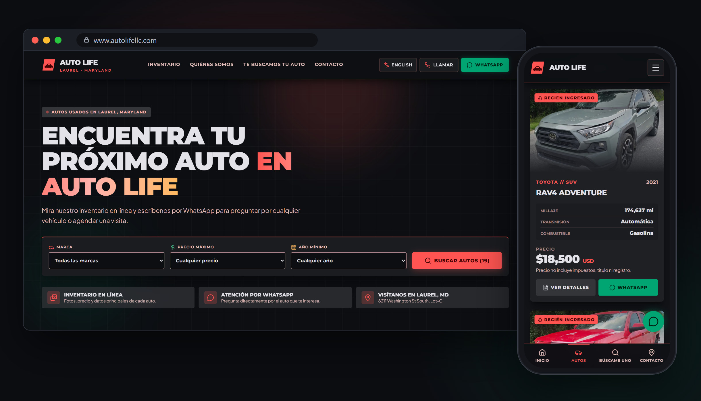
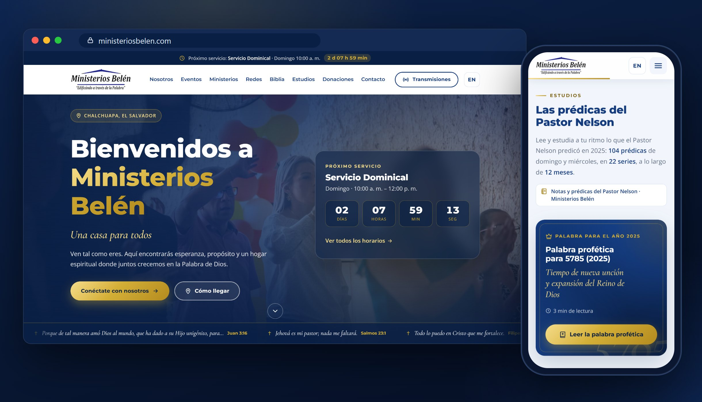

  

  
  
  

## 👋 Hola, soy Héctor

Desarrollador web **freelance** en El Salvador. Hago sitios para negocios y organizaciones que se ven bien en el celular, cargan rápido,
funcionan en **español e inglés** y traen un panel sencillo para que el dueño actualice su información sin depender de nadie.

- ✅ **Recién entregados y en línea:**
  - [Ministerios Belén](https://ministeriosbelen.com), sitio bilingüe de una iglesia cristiana en Chalchuapa,
    El Salvador.
  - [AUTO LIFE](https://www.autolifellc.com), catálogo bilingüe de un concesionario de autos usados en Laurel,
    Maryland (EE. UU.), hecho junto al equipo LAB.
- 🔭 **Ahora mismo:** disponible para proyectos nuevos.
- 💬 **Pregúntame sobre:** Next.js, Supabase, seguridad web, SEO para negocios locales y sitios bilingües.
- 📫 **¿Quieres una página web?** Escríbeme por [WhatsApp](https://wa.me/50375555736).

## 🛠️ Lo que hago

- 🌐 **Sitios para negocios y organizaciones:** catálogos, páginas de servicios y contacto directo por WhatsApp.
- 🗂️ **Paneles de administración** para personal no técnico: subir fotos, cambiar precios, marcar un producto como vendido.
- 🌎 **Español e inglés de punta a punta:** cada idioma con su propia dirección, para que Google muestre el correcto.
- 🔒 **Seguridad desde el diseño:** reglas en la base de datos, sesiones protegidas y límite de intentos al iniciar sesión.
- 🔎 **Google y asistentes de IA:** datos estructurados, sitemap y `llms.txt` para que el negocio aparezca y se entienda bien.
- ⚡ **Velocidad y accesibilidad:** Lighthouse en verde y revisión WCAG 2.1 AA en cada página.

## ⭐ Proyectos destacados

### AUTO LIFE · Catálogo bilingüe de autos usados · Laurel, Maryland, EE. UU.

  
  

Sitio público y panel de administración. El cliente ve el inventario con fotos reales, filtra por marca, precio o
tipo, y escribe por WhatsApp; el personal publica y actualiza los autos desde el celular. Proyecto hecho en
colaboración con el equipo **LAB**.

- 🔴 **Inventario en vivo:** cuando un auto se marca como vendido, cambia en todas las pantallas abiertas en
  ~1 segundo, sin recargar.
- 🌎 **Bilingüe de punta a punta:** sitio, panel y descripciones en español e inglés, sin traductores externos.
- 🔑 **Panel para personal no técnico:** inicio con Google o con contraseña, recuperación por código y límite de
  intentos.
- 🛡️ **Seguridad:** el navegador nunca habla directo con la base de datos; reglas RLS en PostgreSQL, sesiones
  `httpOnly` y política de contenido (CSP).
- 🔎 **SEO y autoridad:** datos estructurados (AutoDealer, Car, FAQ), una versión por idioma, sitemap y `llms.txt`
  para asistentes de IA.
- ✅ **Calidad medida:** cientos de pruebas automáticas en el navegador (Playwright) antes de cada entrega.
- 🚀 **Lanzamiento completo:** dominio propio con HTTPS, sitio ya indexado en Google, servidor en la misma región que
  la base de datos y llaves de acceso renovadas antes de abrir al público.
- 📘 **Manual de usuario** con capturas en celular y computadora, para que el personal use el panel por su cuenta.

  
  
  
  

`Next.js` · `React` · `TypeScript` · `Tailwind CSS` · `Supabase` · `PostgreSQL` · `Vercel` · `GitHub Actions` · `Playwright`

> 🔒 El código es privado: es un proyecto de cliente.

### Ministerios Belén · Sitio web bilingüe de una iglesia cristiana · Chalchuapa, El Salvador

  
  

Un solo lugar para la comunidad de la iglesia: horarios, eventos, ministerios, prédicas, transmisiones en vivo y
donaciones, pensado primero para el celular. El equipo de multimedia actualiza eventos y fotos por su cuenta.

- 🔴 **Directos automáticos:** la barra superior cambia sola a "En vivo ahora" cuando el canal de YouTube empieza a
  transmitir, sin recargar la página y sin claves de API.
- 📖 **Biblioteca de prédicas:** 104 prédicas convertidas desde Word con un script propio, con buscador, filtros,
  recorrido por meses y un lector con tamaño de letra y progreso.
- 🌎 **Español e inglés:** un botón cambia todo el sitio al instante, incluidas las 104 prédicas traducidas y los
  versículos en una Biblia de dominio público.
- 🗂️ **Panel para el equipo de multimedia:** eventos, álbumes, galería y equipos de cada ministerio desde el celular,
  con revisión antes de publicar, acceso solo desde dispositivos autorizados y un manual en PDF.
- 📝 **Libreta de notas privada:** las notas de cada persona se quedan en su dispositivo; nunca se envían a un servidor.
- 📺 **Redes en un solo lugar:** últimos videos de YouTube con "A continuación", TikTok, Instagram y Facebook, y una
  ventana por ministerio con su equipo, fotos y videos.
- 🍪 **Privacidad de verdad:** sin permiso del visitante no se carga nada de TikTok, Instagram, Facebook ni Google Maps,
  y las fotos siguen una política de imagen que protege a los menores.
- 🔎 **Google y asistentes de IA:** ficha de la iglesia con dirección y horarios (datos estructurados `Church`),
  vista previa con foto al compartir, sitemap y `llms.txt` generados en cada publicación.
- ⚖️ **Centro legal:** privacidad, cookies, términos, donaciones, uso de imagen y accesibilidad.
- ⚡ **Liviano:** CSS propio sin frameworks y animaciones que respetan la opción "reducir movimiento".

  
  
  
  
  

`React` · `Vite` · `CSS` · `Vercel Functions` · `Vercel Middleware` · `Sveltia CMS` · `Python`

> 🔒 El código es privado: es un proyecto de cliente.

## 🧭 Cómo trabajo

1. **Entiendo el negocio:** qué vende, a quién y cómo lo contactan sus clientes.
2. **Propuestas de diseño:** varias opciones para elegir antes de construir.
3. **Desarrollo con pruebas:** cada cambio pasa revisiones automáticas de código, diseño, accesibilidad y seguridad.
4. **Lanzamiento:** dominio, seguridad y Google listos, con una guía paso a paso.
5. **Acompañamiento:** mantenimiento y mejoras después de publicar.

## 🧰 Tecnologías

**Frontend** 

**Backend y datos** 

**Despliegue y calidad** 

## 📬 Contacto

¿Quieres una página web para tu negocio? Escríbeme por WhatsApp y te respondo.

---

<b>🌐 English version</b>

### 👋 Hi, I'm Héctor

Freelance web developer based in El Salvador. I build websites for businesses and organizations that look great on phones, load fast, work
in **English and Spanish**, and come with a simple admin panel so owners can update their information on their own.

- ✅ **Just delivered and live:**
  - [Ministerios Belén](https://ministeriosbelen.com), a bilingual website for a Christian church in Chalchuapa,
    El Salvador.
  - [AUTO LIFE](https://www.autolifellc.com), a bilingual catalog for a used car dealership in Laurel, Maryland (USA), built with the LAB team.
- 🔭 **Currently:** available for new projects.
- 💬 **Ask me about:** Next.js, Supabase, web security, local-business SEO and bilingual websites.
- 📫 **Want a website?** Message me on [WhatsApp](https://wa.me/50375555736).

### 🛠️ What I do

- 🌐 **Websites for businesses and organizations:** catalogs, service pages and direct contact on WhatsApp.
- 🗂️ **Admin panels** for non-technical staff: upload photos, change prices, mark an item as sold.
- 🌎 **English and Spanish end to end:** each language has its own address, so Google shows the right one.
- 🔒 **Security by design:** database rules, protected sessions and login attempt limits.
- 🔎 **Google and AI assistants:** structured data, sitemap and `llms.txt` so the business shows up and is understood.
- ⚡ **Speed and accessibility:** green Lighthouse scores and WCAG 2.1 AA checks on every page.

### ⭐ Featured project: AUTO LIFE, bilingual used car catalog (Laurel, Maryland, USA)

✅ **Live since October 2026** at [autolifellc.com](https://www.autolifellc.com). Public website and admin panel. Customers browse the inventory with real photos, filter by make, price or body style,
and message the dealer on WhatsApp; staff publish and update cars from their phones. Built together with the
**LAB** team.

- 🔴 **Live inventory:** when a car is marked as sold, every open screen updates in about 1 second, no reload needed.
- 🌎 **Bilingual end to end:** website, admin panel and descriptions in English and Spanish, with no external translator.
- 🔑 **Admin panel for non-technical staff:** sign in with Google or a password, code-based recovery and attempt limits.
- 🛡️ **Security:** the browser never talks to the database directly; PostgreSQL RLS rules, `httpOnly` sessions and a
  Content Security Policy.
- 🔎 **SEO and authority:** structured data (AutoDealer, Car, FAQ), one version per language, sitemap and `llms.txt`
  for AI assistants.
- ✅ **Measured quality:** Lighthouse 90–95 on mobile and 100 on desktop; accessibility, best practices and SEO at
  100; hundreds of automated browser tests (Playwright) before every release.
- 🚀 **Full launch:** custom domain with HTTPS, already indexed by Google, server in the same region as the database,
  and access keys renewed before going public.
- 📘 **User manual** with phone and desktop screenshots, so staff can run the admin panel on their own.

> 🔒 The code is private: it's a client project.

### ⭐ Featured project: Ministerios Belén, bilingual website for a Christian church (Chalchuapa, El Salvador)

✅ **Delivered and live** at [ministeriosbelen.com](https://ministeriosbelen.com). One place for the church community:
schedules, events, ministries, sermons, live streams and donations, designed mobile-first. The media team updates
events and photos on their own.

- 🔴 **Automatic live streams:** the top bar switches to "Live now" by itself when the YouTube channel goes live, with no
  page reload and no API keys.
- 📖 **Sermon library:** 104 sermons converted from Word with a custom script, with search, filters, a month-by-month
  view and a reader with text size and progress.
- 🌎 **Spanish and English:** one button switches the whole site instantly, including all 104 translated sermons and
  verses from a public-domain Bible.
- 🗂️ **Admin panel for the media team:** events, albums, gallery and ministry teams from a phone, with review before
  publishing, access only from authorized devices, and a PDF manual.
- 📝 **Private notebook:** each person's notes stay on their own device and are never sent to a server.
- 📺 **Social media in one place:** latest YouTube videos with "Up next", TikTok, Instagram and Facebook, plus a window
  for each ministry with its team, photos and videos.
- 🍪 **Real privacy:** nothing from TikTok, Instagram, Facebook or Google Maps loads without the visitor's consent, and
  photos follow an image policy that protects minors.
- 🔎 **Google and AI assistants:** church listing with address and service times (`Church` structured data), photo
  preview when shared, and a sitemap and `llms.txt` generated on every release.
- ⚖️ **Legal center:** privacy, cookies, terms, donations, image use and accessibility.
- ⚡ **Lightweight:** hand-written CSS with no frameworks, and animations that respect "reduce motion".
- ✅ **Measured quality:** Lighthouse 93–94 on mobile and 98–100 on desktop; accessibility, best practices and SEO at 100.

> 🔒 The code is private: it's a client project.

### 🧭 How I work

1. **Understand the business:** what it sells, to whom, and how customers reach it.
2. **Design options:** a few proposals to choose from before building.
3. **Build with tests:** every change goes through automated code, design, accessibility and security checks.
4. **Launch:** domain, security and Google set up, with a step-by-step guide.
5. **Ongoing support:** maintenance and improvements after launch.

